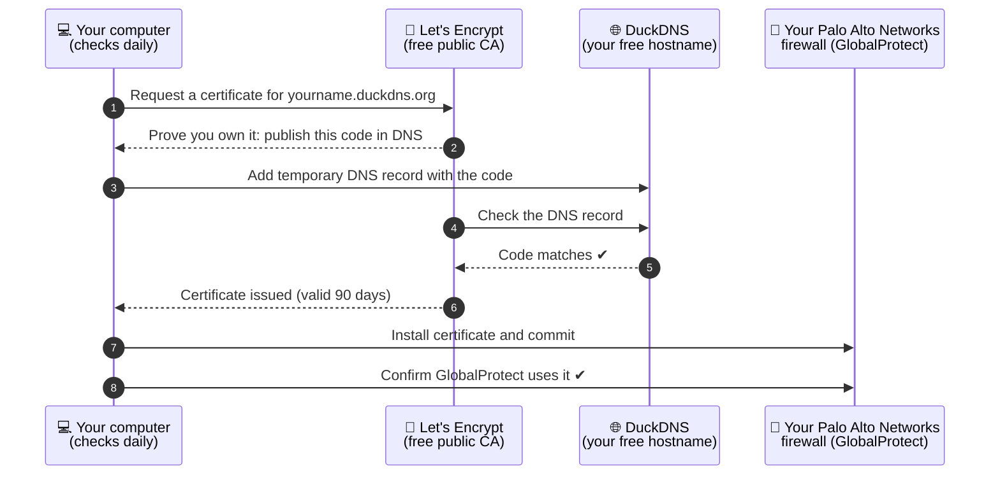

# Free public certificate and management for Palo Alto Networks GlobalProtect

A **free public certificate** for the GlobalProtect portal on your Palo Alto Networks firewall, plus **free certificate management**: it renews, installs, switches GlobalProtect to it, and commits, all automatically.

- ✅ Publicly trusted: no certificate warnings on laptops and phones, and nothing to install on them
- ✅ No static IP needed and no domain to buy: uses a free DuckDNS hostname
- ✅ Runs on **macOS, Windows or Linux**. Set it up once, then forget about it

---

## How it works



Every 2 weeks, your computer gets a new certificate from **Let's Encrypt** (a free public certificate authority trusted by every device). It proves you own the hostname by briefly adding a DNS record at **DuckDNS**. Then it installs the certificate on the firewall and commits, the same as you would by hand.

If the computer is asleep, off, or away from home at the scheduled time, it catches up the next time it's on your home network.

🛡️ **It never touches a firewall with uncommitted changes.** If any administrator has changes that aren't committed yet, it installs nothing, leaves those changes alone, and tries again the next day. When it does commit, it's a *partial commit* of its own admin account's changes only.

---

## You need

- A Palo Alto Networks firewall with GlobalProtect
- **Dynamic DNS on the firewall's WAN interface, set up for DuckDNS**, so your hostname follows your IP: [Palo Alto Networks docs: Configure Dynamic DNS for Firewall Interfaces](https://docs.paloaltonetworks.com/ngfw/networking/ddns/configure-dynamic-dns-for-firewall-interfaces). Setup checks this for you.
- A firewall admin account for the tool, with XML API permissions **Import**, **Commit** and **Operational Requests**. Optional extras:
  - **Configuration**: lets Setup switch GlobalProtect to the certificate for you (otherwise it tells you what to click)
  - **Log**: lets Setup also check the DDNS update logs
- A computer on your home network: macOS, Windows 10/11 or Linux

### Dependencies

| Dependency | Version | How to get it |
|---|---|---|
| **Python** | 3.8 or newer | **macOS:** already installed, or macOS offers to install it the first time you run Setup. **Windows:** install from [python.org](https://www.python.org/downloads/) and tick **Add python.exe to PATH**. **Linux:** already installed on most distributions (otherwise `sudo apt install python3` or similar). |
| [lego](https://github.com/go-acme/lego) (Let's Encrypt client) | latest | Nothing to do: Setup downloads it automatically and verifies the download. |

No other software or Python packages are needed.

---

## Setup (about 5 minutes, once)

### Step 1 — Download

At the top of this page click the green **Code** button → **Download ZIP**, unzip it, and move the folder somewhere permanent.

**Or, with git:**

macOS / Linux (Terminal):
```
git clone https://github.com/bartpmika/letsencrypt-duckdns-globalprotect.git ~/letsencrypt-duckdns-globalprotect
```

Windows (Command Prompt):
```
git clone https://github.com/bartpmika/letsencrypt-duckdns-globalprotect.git "%USERPROFILE%\letsencrypt-duckdns-globalprotect"
```

With git, macOS doesn't show the "can't verify" warning in Step 2, and `git pull` updates the tool later.

> **macOS:** put it in your home folder (the one with your name), not in Desktop, Documents or Downloads. macOS blocks automatic renewals there. The git command above already does this.

### Step 2 — Run Setup

| macOS | Windows | Linux |
|---|---|---|
| Double-click **`Setup.command`** | Double-click **`Setup.bat`** | Run `./gpcert.py setup` |

> **macOS:** if it says it can't verify the file, go to **System Settings → Privacy & Security** → **Open Anyway**. **Windows:** if SmartScreen appears, click **More info → Run anyway**.

Setup asks a few questions and **tests each answer straight away**:

| Question | What it checks |
|---|---|
| DuckDNS hostname and token | The name resolves and the token works |
| Firewall IP and admin username | The firewall answers |
| How to log in: **generate an API key from the password** (recommended), **use an existing API key** ([how to get one](https://docs.paloaltonetworks.com/ngfw/api/api-authentication-and-security/generate-api-key)), or **store the password** | The login works |
| *(automatic)* | Scans **all** firewall interfaces for DuckDNS Dynamic DNS for your hostname, checks the interface IP matches DuckDNS, and reads the last DDNS update in the logs. If something is off it **warns you and waits** |

> 🔑 An API key stops working when that admin's password changes. After a password change, just run Setup again.

Setup then:

1. Gets the certificate and installs it on the firewall as **`gp-letsencrypt`**, then commits.
2. **Switches GlobalProtect to it.** It finds every GlobalProtect portal and gateway on the DuckDNS interface, shows them, and asks *"Switch them automatically?"* On **y**, it creates an SSL/TLS Service Profile `gp-letsencrypt` with the same TLS settings as the current one, points those portals and gateways at it, and commits. Your existing profiles aren't changed, so anything else sharing them (such as the web UI) is unaffected.
3. Turns on automatic renewal and shows the final status.

`gp-letsencrypt` already includes the full certificate chain (the Let's Encrypt intermediates), so you don't need to import any CA certificates. Use `yourname.duckdns.org` as the portal address in GlobalProtect.

<details>
<summary>Prefer to switch by hand, or the admin lacks the Configuration permission?</summary>

Answer **n**, and Setup shows exactly which profile to change and waits while you do it:
**Device → Certificate Management → SSL/TLS Service Profile** → your GlobalProtect profile → **Certificate:** `gp-letsencrypt` → **OK** → **Commit**

</details>

---

## Day to day

Nothing to do. On macOS and Linux a notification pops up if a renewal fails. On every system, **Check Status** shows the last result.

| To… | macOS | Windows | Linux |
|---|---|---|---|
| See if everything is OK | `Check Status.command` | `Check Status.bat` | `./gpcert.py status` |
| Renew right now | `Renew Now.command` | `Renew Now.bat` | `./gpcert.py renew` |
| Turn off automatic renewal | `Uninstall.command` | `Uninstall.bat` | `./gpcert.py uninstall` |

**Check Status** looks like this:

```
  ✔ Last run:      OK 2026-11-07 20:44
  ✔ Expires:       2027-02-05
  ✔ Next renewal:  2026-11-21
  ✔ Schedule:      on
  ✔ Firewall has the current certificate as 'gp-letsencrypt'
  ✔ GlobalProtect portal 'GP-external' uses 'gp-letsencrypt' (profile 'gp')
  ✔ GlobalProtect gateway 'gp-external' uses 'gp-letsencrypt' (profile 'gp')
  ✔ Portal yourname.duckdns.org:443 is serving the current certificate
```

**About the portal check:** from inside your network the portal's public address often isn't reachable without a U-turn/no-NAT rule. Setup records whether it was reachable *before* making any changes. If it wasn't, Status shows a ⚠ warning instead of an error, and relies on the checks it makes directly on the firewall.

---

## If something goes wrong

| Message | What to do |
|---|---|
| *firewall unreachable* | The computer wasn't at home. Nothing to do: it catches up when you're back. |
| *the firewall has uncommitted changes* | Someone left unfinished changes. Commit or revert them; the tool tries again the next day. It never commits other people's work. |
| *firewall said: Invalid Credential* | The password changed (so the API key no longer works). Run Setup again. |
| *No interface on the firewall updates …* | Set up Dynamic DNS for DuckDNS on your WAN interface ([docs](https://docs.paloaltonetworks.com/ngfw/networking/ddns/configure-dynamic-dns-for-firewall-interfaces)). |
| *… DuckDNS points to …, so the firewall's updates aren't working* | Check **Monitor → Logs → System** with `( subtype eq ddns )`. |
| *uses certificate '…', not 'gp-letsencrypt'* | Run Setup again and answer **y** to *Switch them automatically?* |

To change any setting, run Setup again. It remembers your answers, so press Enter to keep each one.

---

<details>
<summary><b>Under the hood (for the curious)</b></summary>

- **One script, no extra packages:** `gpcert.py` uses only the Python standard library. The double-click files just run it.
- **Certificate:** Let's Encrypt over ACME with the **DNS-01** challenge, a TXT record at `_acme-challenge.<hostname>` set through DuckDNS's API. The ACME client is [lego](https://github.com/go-acme/lego). Setup downloads the right build for your OS and CPU from its GitHub releases and verifies the checksum.
- **Firewall (PAN-OS XML API):** certificate and key import, then a **partial commit** limited to the tool's admin. The tool waits for the commit job to finish and reads the certificate back to confirm it. Before importing it runs `check pending-changes` and skips the upload if anything is uncommitted.
- **Checks via operational commands only:** configuration is read with `show config running`, so the admin doesn't need the XML API *Configuration* permission. DDNS is found by scanning every interface, subinterface, AE, VLAN, loopback and tunnel for `ddns-config`. The interface IP comes from the DHCP client state or the static address.
- **Schedule:** macOS launchd agent; Windows Task Scheduler (daily, at logon, and *run as soon as possible if missed*); Linux systemd user timer (`Persistent=true`) or cron. Renewal happens every `renew_days`. Deployment happens only when the firewall doesn't have the current certificate yet.
- **Secrets:** `data/config.json` holds the DuckDNS token and the API key (or the password, if you chose to store it). It's readable only by your user and excluded from git, along with `data/`, `bin/` and `logs/`.
- **Tested on:** macOS (Apple silicon, Python 3.9). Linux in Debian 12 (Python 3.8, ARM64), Debian 13 (Python 3.13, x86-64) and Ubuntu 24.04 (Python 3.12, ARM64), all with the cron schedule; the systemd timer hasn't been tested yet. **Windows hasn't been tested on a real machine yet.** Please [open an issue](../../issues) if something doesn't work.
- **Automatic GlobalProtect switch:** portals are matched by `portal-config/local-address/interface`, gateways by `local-address/interface`. A gateway with no interface binding is included if it shares an SSL/TLS profile with a matched portal. The new profile is created in `shared` with the old profile's `protocol-settings` copied over. If any step fails, the tool reverts its own candidate changes (`revert config partial admin`).
- **Safety:** before installing, the tool runs `check pending-changes`, which covers every administrator's uncommitted changes, and it refuses to install a Let's Encrypt *staging* (test) certificate.

| File | Purpose |
|---|---|
| `gpcert.py` | Everything: `setup`, `renew`, `status`, `uninstall` |
| `*.command` / `*.bat` | Double-click launchers for macOS / Windows |
| `extras/clientless-redirect-fix.user.js` | Optional Tampermonkey script for GlobalProtect **clientless VPN**: stops apps that redirect to `/…` from bouncing you back to the portal |

</details>

Built on [Let's Encrypt](https://letsencrypt.org), [lego](https://github.com/go-acme/lego) and [DuckDNS](https://www.duckdns.org). MIT license.
